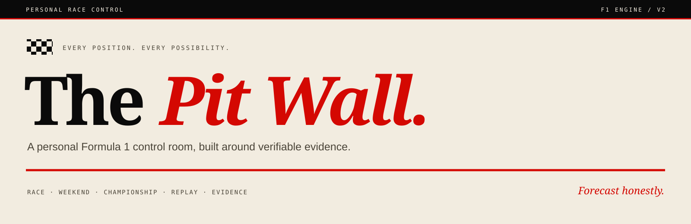
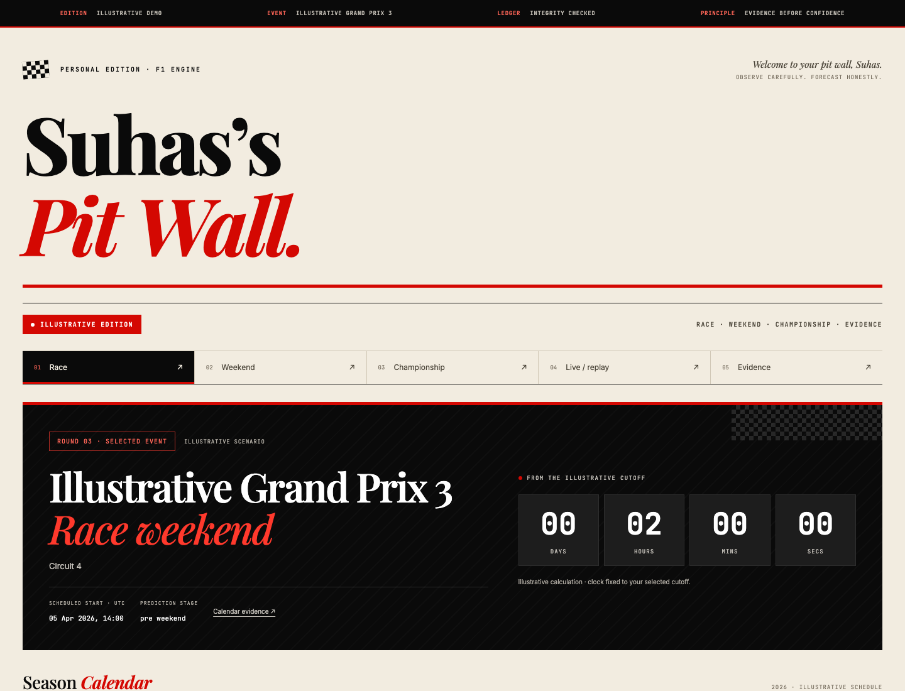
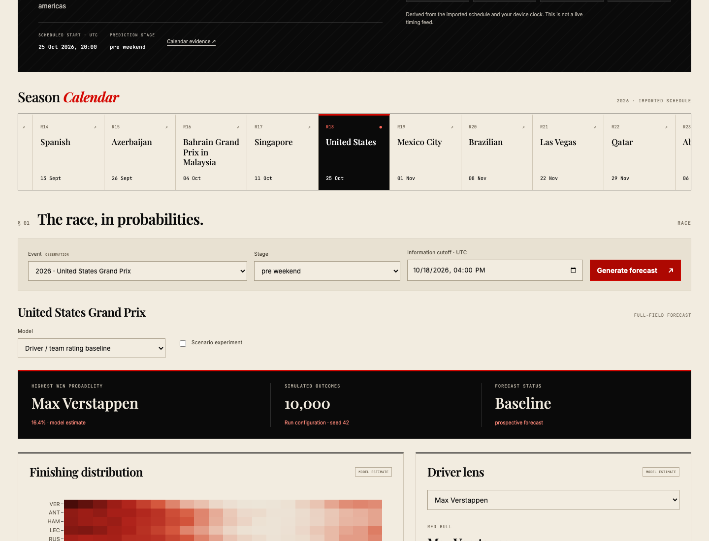
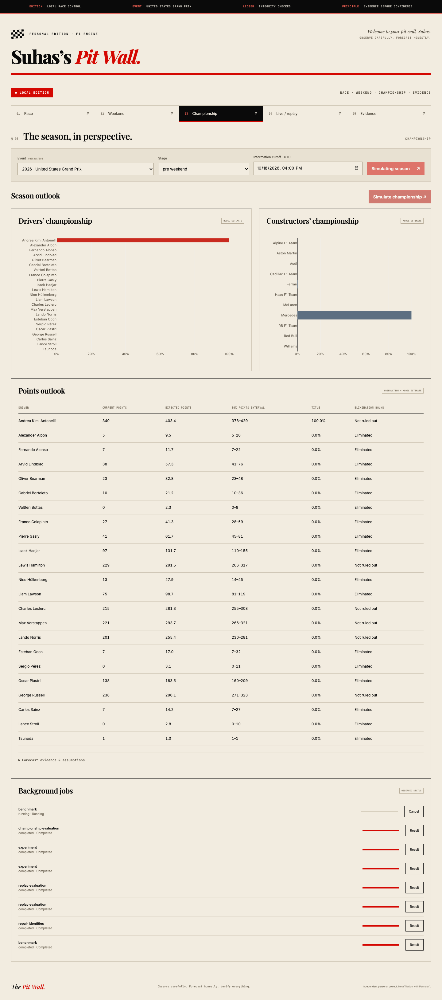

<p align="center">
  
</p>

<p align="center">
  <strong>Whole-field race forecasts. Championship simulations. Evidence you can inspect.</strong>
</p>

<p align="center">
  <a href="#start-your-engine">Get started</a> ·
  <a href="#inside-the-pit-wall">Explore the app</a> ·
  <a href="docs/v2/release-evidence.md">Validation report</a> ·
  <a href="docs/v2/README.md">Technical guide</a>
</p>

<p align="center">
  
  
  
  
</p>

---

## Your race weekend, in one place

**The Pit Wall** is a personal Formula 1 forecasting application by Suhas Nannapaneni. It brings race distributions, championship outlooks, weekend inputs and replay analysis into a single local workspace.

The interface pairs warm paper, editorial typography and racing red with detailed probability charts. Underneath, each saved forecast retains its inputs, sources, cutoff, model version and simulation settings.

<p align="center">
  
  <br />
  <sub>Offline demo shown. Its drivers, schedule and results are explicitly illustrative.</sub>
</p>

## Inside the Pit Wall

| Workspace | What you can do |
| :--- | :--- |
| **Race** | Explore every finishing position, win and podium probabilities, head-to-heads and scenario changes. |
| **Weekend** | Inspect practice pace, qualifying, tyres, weather inputs and missing-data coverage. |
| **Championship** | Simulate the remaining season from official standings, including sprints and countback. |
| **Live / replay** | Replay arrival-ordered timing and inspect how remaining-race forecasts change. |
| **Evidence** | Examine sources, calibration, candidate comparisons, forecast history and background jobs. |

<details>
<summary><strong>See the forecast and championship workspaces</strong></summary>

### Race probabilities



### Championship outlook



These screenshots show saved model estimates from the recorded dataset. They are not current standings, guaranteed outcomes or accuracy claims.

</details>

## Start your engine

**Requirements:** Python 3.13. The validated platform is macOS ARM64; Windows is not currently supported. Node is only needed when changing the frontend.

```sh
git clone https://github.com/Suh7s/f1-aii-engine.git
cd f1-aii-engine
./scripts/setup-v2.sh
source .venv-v2/bin/activate
f1engine app
```

Open **[localhost:8765](http://127.0.0.1:8765)**.

For a fully offline tour with fictional fixtures:

```sh
f1engine app --demo
```

To import a season from public sources:

```sh
f1engine sync 2024
```

The UI, charts and fonts are bundled. Baseline forecasts run locally on CPU. Experiments use four training threads, up to twelve candidates and resumable jobs capped at 45 minutes. Optional XGBoost training on macOS needs `brew install libomp`.

## Evidence before confidence

Every number has a role: **observation, model estimate, user assumption, derived calculation or illustrative scenario**. Historical reconstruction, held-out evaluation and prospective forecasting remain separate.

- **Traceable forecasts.** Sources, retrieval times, versions, seeds, simulation counts and missing inputs travel with the result.
- **Preserved history.** Corrections create linked revisions in an append-only ledger.
- **Honest failures.** Missing inputs stay missing. Stale timing stops new live forecasts.
- **Measured promotion.** More complex models must earn their place against a named baseline.

### Verified checkpoint · 18 October 2026

| Check | Recorded result |
| :--- | :--- |
| Offline engine tests | **104 passed** |
| Browser checks | **7 passed**, including mobile and offline fonts |
| Clean installation | Startup, packaged assets and exact forecast reproduction passed |
| 10,000 race simulations | **0.179 seconds** — slowest of three cached runs |
| 10,000 season trajectories | **4.611 seconds** — slowest of three cached runs |

Runtime measurements use an illustrative 20-driver fixture with 22 remaining rounds on the recorded machine. They measure speed, not predictive accuracy.

**Research release:** prospective accuracy, championship calibration and live-feed readiness are still being validated. The pre-race baseline remains active. One Python dependency advisory has a [documented exception](docs/v2/SECURITY.md). See the [full evidence report](docs/v2/release-evidence.md) for passed checks, failed gates and remaining limitations.

## Built for local work

| Layer | Technology |
| :--- | :--- |
| Application | Python 3.13 · FastAPI · React · TypeScript · Vite · Plotly |
| Storage | SQLite metadata · partitioned Parquet · retained raw responses |
| Modeling | Probability baselines · regularized strength · XGBoost ranking · chronological ensembles |
| Public data | Jolpica · FastF1 · OpenF1 archives · Open-Meteo |

Active application code lives in [`v2/f1engine`](v2/f1engine) and [`web`](web). The [original implementation documentation](docs/legacy/README.md) is preserved separately as reference.

For setup, APIs, experiments and replay commands, see the [technical guide](docs/v2/README.md).

---

<p align="center"><em>Observe carefully. Forecast honestly. Verify everything.</em><br /><sub>Independent personal project. Not affiliated with Formula 1, the FIA or any team.</sub></p>
